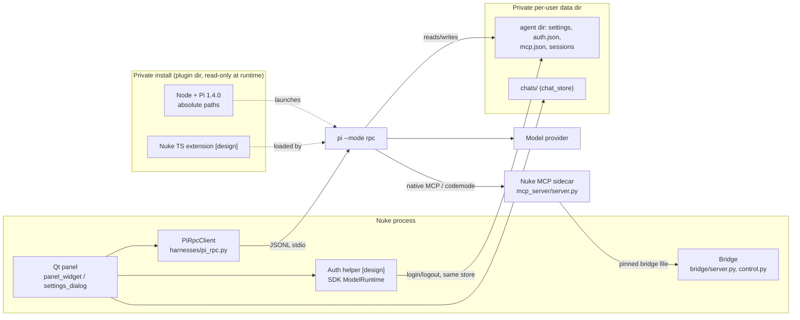

# Architecture: private Pi runtime

Owns module responsibilities, data/auth/session/env flows, and verified public interfaces.
Requirements, decisions, non-goals, research: [PLAN-pi-runtime.md](PLAN-pi-runtime.md).
Ordered tasks, status, live acceptance, review workflow: [INTEGRATION-pi-runtime.md](INTEGRATION-pi-runtime.md).

Legend: **[baseline]** = exists in the repo now (read from source). **[verified-1.4]** = public Pi 1.4.0 interface read in the installed package docs/types (`@earendil-works/pi-coding-agent`, sibling `pi-ai`). **[design]** = not built, not proven; open questions are listed in the last section.

## Shape

Keep the current Qt panel and Pi RPC client. Change only *which* Pi runs, *where* its state lives, *what* it loads, and add one small auth helper. Nuke stays the authority for graph state, Python trust, API gates and leases.

## Module responsibilities

| Concern | Owner | Notes |
|---|---|---|
| Resolve program, build args/env, process lifecycle | `harnesses/base.py` `JsonlProcessClient`; `harnesses/pi_rpc.py` `PiRpcClient` | **[F1 implemented]** For pi, `resolve_runtime` (Qt-free) returns the absolute private Node and official `dist/bundle/rpc-entry.js` (already RPC; no `--mode`). No QSettings/`NUKE_PI_BIN`/`PATH`/global fallback; missing runtime is a clear error (pid 0). Presence/executable checks per start, uncached; pinned metadata cache allowed. Version/lock/file consistency is not tamper-proof. Other harnesses keep `resolve_binary`. |
| Agent dir | `pi_rpc._agent_dir`, called from `harnesses/__init__.py::_make_pi` | **[F1 implemented]** Pi uses `chats_root().parent/'pi'` (0700; atomic unique 0600 JSON settings; auth/unrelated private files preserved). `omp` keeps its behavior. |
| Private install location | `PROJECT_ROOT/runtime/pi` (see its README) | **[F1 implemented]** Fresh official Pi 1.4.0 from npm (Node's own npm, 121 deps, private install, not a global copy) and official Node 26.12.0 linux-x64 (SHA256 vs official SHASUMS over TLS; no GPG). `node` and `node_modules` are git-ignored (~375 MB). Not a release wheel/distribution/cross-platform (F6). |
| Private data dir | follows `chat_store.chats_root()` (Qt `AppDataLocation`, fallback `~/.local/share/nuke-codex-panel`) | **[F1 implemented]** agent dir sits beside it, separate from install so upgrades never touch it. |
| MCP registration | `harnesses/nuke_mcp.py` (`server_command`, `server_environment`, `merge_agent_mcp_config`) | **[F1 implemented]** Private `mcp.json` holds only the `nuke` entry; the inherited bridge pin `NUKE_CODEX_BRIDGE_FILE` is never persisted. |
| Prompt | `PiRpcClient.system_prompt` + `PI_NATIVE_MCP_GUIDANCE`; `launch_arguments` | **[F1 implemented]** `--system-prompt` replaces Pi's default coding prompt with the shared mandatory Nuke guidance plus native codemode docs; append flag dropped. Replacement is checked via measured `/nuke_runtime` diagnostics (argv claims kept separate), not assumed. Retrieval cues to `nuke_codex_panel/knowledge/` stay in the prompt. |
| Mechanical tool/result handling | Nuke TS extension | **[F1: `nuke-runtime.ts` only]** Explicit, project-owned, read-only `/nuke_runtime` command appends a non-LLM custom entry (process/version/config/source/tool/prompt/env diagnostics; allowlisted safe settings, redacted argv, no credentials/tokens). It is not a model tool and changes no guidance/trust/epoch/steering. **[F3 implemented and live-exercised, READY for user acceptance, NOT ACCEPTED]** the same sole entry also carries the `tool_call` surface guard, ordinary/nested `tool_result` forwarding (uncapped, per-in-flight-parent transient evidence; per-parent image dedupe; caught api_errors; explicit may-still-execute warning for unresolved/aborted nested calls; no persistent cache) and a live pinned-bridge probe in `/nuke_runtime` (reused per-process diagnostic client id; `activeOperations` null, wire API unavailable) (see INTEGRATION F3 for the live evidence). The surface guard is not an OS sandbox or provider-helper isolation, and its blocked-hook scenario is source-reviewed only (not live-triggerable under the closed loadout); it must not duplicate bridge state or pre-validate arbitrary Python. Explicit extensions only: `builtin:mcp`/`codemode`/`tool-search` + `nuke-runtime.ts`; skills/prompts/context/themes/autoload disabled. |
| Nuke state, Python trust, graph/API gates, leases, runtime evidence | existing bridge (`bridge/*`, `api_recovery.py`) | **[baseline]** Authority. Pi and the extension request; the bridge decides. |
| Auth | new minimal module (e.g. `harnesses/pi_auth.py`) driven by `settings_dialog.py` | **[design]** See Auth flow. Not a second assistant engine and never carries a conversation. |
| Sessions, steering, renewal | `PiRpcClient` (`_renew_process`, `_abort_run`, `can_renew_session`), `bridge/control.py` | **[baseline]** Unchanged; re-validated with the private runtime (F5). |

## Environment flow

**[baseline]** `JsonlProcessClient.start` starts from `QProcessEnvironment.systemEnvironment()` and inserts `launch_environment()` keys (`CONTROL_ID_ENV`, bridge pin, `CONTROL_EPOCH_ENV`). Desktop-launched Nuke therefore passes everything inherited.

**[F1 implemented]** Two classes of variable, handled differently:

- **Desktop inheritance — keep.** `DISPLAY`, `WAYLAND_DISPLAY`, `XDG_RUNTIME_DIR`, `DBUS_SESSION_BUS_ADDRESS`, `XAUTHORITY`, `PATH` basics, locale. Needed for browser-open during OAuth and for Nuke-side tooling. Do not replace the environment wholesale.
- **Owned auth/config — set explicitly.** `PI_CODING_AGENT_DIR` points at the private agent dir, so no `~/.pi` read or write. All other ambient `PI_*`, `JITI_*` and Node override variables are stripped; `JITI_FS_CACHE=false` (no shared `/tmp` jiti compile cache), `PI_SKIP_VERSION_CHECK=1`, `PI_TELEMETRY=0`. No unverified `PI_OFFLINE` flag is used.
- **Ambient provider credentials — stripped.** 42 generated provider key names and cloud selectors are removed from the child environment; no global credential is borrowed in F1. Whether Pi has a switch that disables env fallback without stripping stays an open question (below).

Not a sandbox: the child still runs as the user with the desktop's file access.

## Auth flow [design]

Gap: RPC has no auth commands ([verified-1.4]). Fill it with a helper that uses the pinned SDK, not a second agent.

- **Surface.** Small Node entry shipped in the private install (same pinned package), spawned by the panel as a short-lived process speaking JSONL on stdio — same pattern as `JsonlProcessClient`. It calls `ModelRuntime.login(provider, type, AuthInteraction)` and `logout` ([verified-1.4]), listing providers/methods dynamically from the runtime. The panel shows only what it reports; not every provider offers subscription login.
- **Callbacks.** `AuthInteraction.prompt` (text / secret / select / manual_code) → Qt dialogs; `notify` (auth_url / device_code / progress / info) → open browser or show code/progress. Cancel, refresh failure and errors map to dialog states. Secret input travels panel → helper over stdin only; never into chat, logs, trace artifacts, argv, env, or the model.
- **Storage.** The helper points at the same private auth path Pi reads (`CredentialStore` / `authPath`, [verified-1.4]). Pi's default is a JSON file, mode 0600 in a 0700 directory, **not encrypted**. Reuse it; an OS keyring is an optional later change, not a prerequisite. Logout removes the local credential only; it does not promise provider-side revocation.
- **Visibility to the running RPC process.** Auth changes must reach `pi --mode rpc` without losing the conversation. Two candidates: a public reload in the running process, or the existing idle process renewal (`_renew_process` / `can_renew_session`, which reopens the same session id). Choose after verification (open question 1). After either, `_query_state` (`get_available_models`) refreshes the model list.
- **Boundary.** No chat turns, tool execution or session ownership in the helper.

## Session flow

**[baseline]** Chats and Pi sessions are Nuke-owned: `store.dir/sessions` passed as `--session-dir`; `--session-id` reopens-or-creates; `session_state`/`resume_session` persist `session_id`/`session_file`. Steering, lease epochs, abort/restore-queue and the 1000 ms *process* stop escalation (not a model timer) live in `PiRpcClient` and `base.py`.

**[design]** Preserved as-is. The private runtime reads the same session dir, so existing Nuke-owned chats continue. Sessions in a global Pi are not imported unless the user asks. Auth changes, extension updates and pinned-version upgrades must not alter session ids or chat files.

## Verified Pi 1.4 interfaces relied on

- RPC mode: `prompt`, `steer`, follow-up, `abort`, clear queue, models/thinking, sessions/tree/fork, `get_commands` (including extension commands), limited extension UI. No auth commands, no full custom-TUI. (`harnesses/pi_rpc.py` already uses the prompt/abort/model/state subset; `_handle_extension_ui` declines dialogs.)
- Extensions: `tool_call` may block; `tool_result` may transform content/details/structuredContent/isError; nested codemode events carry `parentToolCallId`; `ExtensionToolContext.executeTool` runs with normal validation/hooks (not available on every event context); `registerCommand`; `appendEntry` for non-model state.
- Extension loading and reuse: extensions are loaded only by explicit private path from a curated set (project-owned or pinned/licensed/reviewed third-party); no global/project discovery. Candidate upstream extensions are catalogued, untested on 1.4.0, in [RESEARCH-pi-extensions.md](RESEARCH-pi-extensions.md). A third-party extension runs inside Pi and sits behind the bridge: it cannot widen graph/API gates, trust or leases, and its own config, cache and auth must resolve under the private data directory.
- SDK: `ModelRuntime.login/logout`, `AuthInteraction`, `CredentialStore`/private auth path.
- Native MCP + codemode + `tool_search`: proven end to end against real Nuke on the *global* install (SDK → stdio → bridge); MCP `isError` resolves normally in code; images need explicit `image(block)`; long calls survive Pi's 60 s MCP idle limit via the sidecar echoing the progress token. Evidence: `/tmp/nuke-native-pi-HhQb4Y/pytest-output.txt`, `native-pi-smoke-context-fixed-output.txt` (see [INTEGRATION-pi-runtime.md](INTEGRATION-pi-runtime.md) for what is re-run on the private install).

## Explicitly out of the architecture

Automatic updater, generic plugin/extension framework (a curated explicit list is not a framework), embedded terminal/PTY or `InteractiveMode` hosting, Pi fork, ACP bridge, Durable. Claims not made: every Pi slash command works in Qt (TUI-only views are unsupported), cancellation ends provider-side work, stored credentials are encrypted, env stripping is an OS sandbox.

## Open validation points (feature acceptance, not assumptions)

1. **Auth propagation:** implemented in F2 via the existing same-session idle renewal triggered by the `accounts_changed` bus (the public SDK reload does not update a live RPC process's model snapshot). Offline native proof only (`/tmp/nuke-private-pi-f2-v0vdu8t2/batch-native.txt` 7/7, synthetic account-change event; history preserved); real credential propagation is human-gated.
2. **Env fallback:** child-env stripping (generated credential env names, `PI_`, `JITI_`, `AWS_`, `GOOGLE_CLOUD_`, `GCLOUD_`, Node overrides, OAuth host overrides) is the control, shared by RPC and the auth helper via `managed_environment`. Nothing was authenticated from ambient variables in the offline fixtures; real no-ambient-fallback after logout is human-gated.
3. **Helper/runtime store agreement:** the SDK helper (`runtime/pi/auth-helper.mjs`, `harnesses/pi_auth.py`) and `pi --mode rpc` use the identical `<managed Pi dir>/auth.json` and never touch `~/.pi` (`batch-storage.txt` 4/4, offline fixture, fixture key removed by SDK logout).
4. **Providers/methods:** all 50 SDK 1.4.0 entries (41 API-key, 9 OAuth) are listed dynamically; per-provider live callback sequences are shown through generic SDK prompts/events and verified only by a human-approved live login (PENDING).
5. **Extension reach:** which codemode-nested/image/error cases the public hooks cover without `executeTool` on every event context. (F3)
6. **Command surface:** how much of `get_commands` is executable through existing RPC actions, and what extension UI methods RPC supports. (F4)
7. **Steering with private runtime:** manual intervention during thinking and during an already-dispatched Nuke mutation (drain before continuation). (F5)
8. **Upgrade and reopen:** pinned-version change keeps credentials and chats; missing runtime yields a clear error with no global fallback. (F6)
9. **Effective prompt and first authorized request:** F1 verified through the measured `/nuke_runtime` readback on the production RPC child (prompt replacement, absent global/project context, active/callable tools = Nuke MCP/codemode/discovery, no coding tools); no provider request was made. Redacted evidence: `/tmp/nuke-private-pi-f1-nRJLlM/`. The first **user-authorized F2** API-key/subscription RPC turns must still confirm the outgoing effective prompt and private credential source. F3 repeats the prompt check after adding the Nuke extension. Redact provider requests before recording evidence: no keys, tokens or authorization headers in artifacts.
